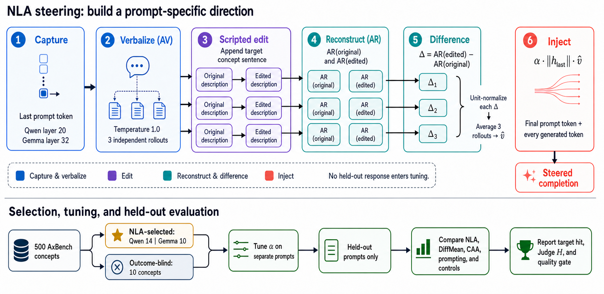

# NLA Steering Effects

This repository contains the code, frozen protocols, saved generations, and
analysis needed to reproduce the natural-language autoencoder (NLA) steering
experiments. It combines the core experiments and later ablations in one
place. Paper source files, progress notes, and transient console logs are not
included.

The repository supports two uses:

1. Recompute results from the saved model outputs without a GPU.
2. Run new generations when the model weights, NLA checkpoints, and a GPU are
   available.

## Workflow

<p align="center">
  
</p>

For each target prompt, the NLA procedure:

1. captures the final prompt-token activation;
2. describes that activation in natural language;
3. adds a sentence about the target concept;
4. reconstructs the original and edited descriptions into activation space;
5. subtracts the two reconstructions to obtain a steering direction; and
6. injects the scaled direction while the target model generates a response.

Concept selection, strength tuning, and held-out evaluation use separate
prompts. The saved protocols preserve that split.

## Quick start

Python 3.10--3.13 is supported.

```bash
git clone <repository-url>
cd nla-steering-effects
python3 run.py self-test
```

The self-test uses saved outputs and the Python standard library. It does not
download model weights, call an API, or use a GPU.

For plots and data tables, install the locked analysis environment:

```bash
./scripts/bootstrap.sh
uv run --locked --extra analysis ./run.py reproduce
```

Generated files are written under `artifacts/rebuilt/` and are ignored by Git.

## Main results

Concept-word incidence is the percentage of responses that contain at least
one word from the concept's fixed word list. Quality pass is the automated
check against a matched unsteered response. These measures should be read
together.

### Selected and independent concept panels

| Model and panel | Method | Responses | Concept-word incidence | Prompt coverage | Quality pass |
|---|---|---:|---:|---:|---:|
| Qwen selected 14 | NLA | 224 | 44.2% | 58.0% | 81.3% |
| Qwen selected 14 | DiffMean | 224 | 17.4% | 24.1% | 95.1% |
| Qwen selected 14 | calibrated CAA | 224 | 11.6% | 17.9% | 96.4% |
| Qwen selected 14 | direct prompting | 224 | 80.8% | 84.8% | 79.0% |
| Qwen selected 14 | unsteered | 224 | 5.8% | 8.0% | 98.2% |
| Gemma on the same 14 | NLA | 224 | 28.1% | 36.6% | 79.5% |
| Gemma on the same 14 | DiffMean | 224 | 10.3% | 13.4% | 60.7% |
| Gemma on the same 14 | calibrated CAA | 224 | 7.6% | 10.7% | 85.7% |
| Gemma on the same 14 | direct prompting | 224 | 87.1% | 92.9% | 84.8% |
| Gemma on the same 14 | unsteered | 224 | 2.7% | 4.5% | 98.2% |
| Gemma independent 10 | NLA | 160 | 38.8% | -- | 83.1% |
| Gemma independent 10 | DiffMean | 160 | 11.9% | -- | 56.9% |
| Gemma independent 10 | SAE | 160 | 3.1% | -- | 78.1% |
| Gemma independent 10 | LoReFT | 160 | 10.0% | -- | 89.4% |
| Gemma independent 10 | direct prompting | 160 | 93.8% | -- | 81.2% |

The complete machine-readable reference contains 188 checked values in
`analysis/expected_results.json`.

### Random 50-concept panel

Each entry uses 800 responses per method and model.

| Model | Method | Concept-word incidence | Prompt coverage | Quality pass |
|---|---|---:|---:|---:|
| Qwen | NLA | 25.1% | 33.3% | 83.0% |
| Qwen | DiffMean | 12.8% | 17.3% | 94.6% |
| Qwen | calibrated CAA | 9.5% | 12.5% | 94.6% |
| Qwen | direct prompting | 78.0% | 86.3% | 78.1% |
| Qwen | unsteered | 7.4% | 10.3% | 96.9% |
| Gemma | NLA | 19.0% | 24.0% | 83.9% |
| Gemma | DiffMean | 10.3% | 14.5% | 68.4% |
| Gemma | calibrated CAA | 4.6% | 7.3% | 90.5% |
| Gemma | direct prompting | 83.9% | 89.5% | 87.0% |
| Gemma | unsteered | 4.5% | 6.0% | 98.0% |

Source summaries are in `lab/reports/random50_panel/output/`.

### Selection and prompt-source ablations

| Experiment | Main result | Interpretation | Saved result |
|---|---|---|---|
| Approximate DiffMean mirror | 65 candidates produced 6 confirmed concepts; DiffMean 46.9%, NLA 36.5%; difference +10.4 points, 95% CI [-3.1, 24.0] | The average ordering reverses, but the interval includes zero. | `artifacts/experiments/diffmean_self_selection_mirror/aggregate_results.json` |
| Strict DiffMean mirror | 65 candidates produced 4 early survivors and 0 confirmed concepts | The strict run does not yield a final comparison panel. | `artifacts/experiments/diffmean_self_selection_mirror_strict/` |
| Prospective symmetric selection | Interaction -11.6 points, 95% CI [-28.4, 5.3] | The run does not establish a selection-method interaction or equivalence. | `artifacts/experiments/prospective_symmetric_self_selection/v1/result.json` |
| Prompt-specific explanation | Current prompt 48.7%, another prompt 27.7%, one fixed prompt 31.3% | Building the direction from the current prompt gives the strongest lexical effect, with lower quality pass. | `artifacts/experiments/nla_explanation_source_panel14/seed_matched/metrics.json` |

The prompt-specific comparison used 224 responses per condition. Current-prompt
steering exceeded the other-prompt condition by 21.0 points, 95% CI [13.0,
28.6], and the fixed-prompt condition by 17.4 points, 95% CI [7.6, 27.7].

### Chosen-in-advance panel and tuning objective

| Model | Method | Judge harmonic score | Strict concept-word incidence |
|---|---|---:|---:|
| Qwen | DiffMean | 0.498 | 26.3% |
| Qwen | NLA | 0.315 | 22.5% |
| Gemma | DiffMean | 0.378 | 32.5% |
| Gemma | NLA | 0.220 | 13.8% |

When steering strength is retuned for concept words instead of the judge score:

| Model | Method | Judge-tuned incidence | Word-tuned incidence | Change |
|---|---|---:|---:|---:|
| Qwen | DiffMean | 26.3% | 43.8% | +17.5 points |
| Qwen | NLA | 22.5% | 47.5% | +25.0 points |
| Gemma | DiffMean | 32.5% | 52.5% | +20.0 points |
| Gemma | NLA | 13.8% | 37.5% | +23.8 points |

These are post-hoc sensitivity results. The complete intervals and per-concept
choices are in `lab/reports/axb44_lexical_alpha_sensitivity/output/`.

### Other completed studies

| Study | Scope | Result location |
|---|---|---|
| Discovery and confirmation | Concept500 search, Qwen 14-concept confirmation, Gemma replication | `artifacts/paper_runs/data/qwen2.5-7b/`, `artifacts/paper_runs/data/gemma3-12b/` |
| Baseline comparison | NLA, DiffMean, fixed and calibrated CAA, random directions, prompting, SAE, LoReFT | `artifacts/paper_runs/data/baseline_panel14/` and model-specific folders |
| Three independent judges | GPT-4o-mini, Haiku, and Luna scores for the selected panel | `artifacts/paper_runs/data/selected_panel_judge_council/summaries/` |
| Human quality rubric | 112 human-only records in two halves of 56; usable rate 48.2% and 67.9%; the first half holds all 13 marked judge disagreements | `artifacts/release/reliability_v1/human_scores_only_56.json`, `artifacts/release/reliability_v1/human_scores_second_56.json` |
| Factuality check | NLA, random control, and unsteered responses | `artifacts/release/reliability_v1/factuality_three_arm.json` |
| Position and wording checks | Injection location, energy matching, and lexical/behavioral/abstract edits | `artifacts/paper_runs/data/cross_model_extended_2026-08-08/` |
| Output-word projection | Whether steering raises target-word ranks in the output vocabulary | model-specific `unembedding_projection*` folders |
| Emoji steering | Qwen and Gemma CAA/NLA comparisons, random controls, dose response | `artifacts/paper_runs/data/freeform_emoji/` and `lab/reports/crossmodel_emoji_results/` |
| Wordle steering | Word and letter directions, controls, and cross-model runs | `artifacts/paper_runs/data/freeform_wordle/` and `lab/experiments/wordle2/` |
| Style steering | capitalization, punctuation, contractions, verbosity, person, lists, and related traits | `lab/results/` and `lab/analysis/figures/summary.csv` |
| Direction geometry | direction similarity, Jacobian-space checks, and mechanism follow-ups | `lab/experiments/jspace*`, `lab/results/jspace_projections.json` |
| Activation editing example | extract, describe, edit, reconstruct, and inject one activation | `ar_edit_poetry_style/` |
| NLA training and data generation | model, rollout, reward, data generation, and training utilities | `nla/`, `configs/`, `reward_experiment/` |

The experimental registry lists all 137 completed extended-lab runs, their
models, methods, result files, record counts, and checksums:
`lab/registry/experiment_manifest.csv`.

## Repository layout

| Path | Contents |
|---|---|
| `run.py` | Common verification, analysis, and reproduction commands |
| `analysis/` | Offline aggregations, expected values, and figure generation |
| `artifacts/release/` | Small frozen inputs used by the self-test |
| `artifacts/paper_runs/data/` | Saved core experiment outputs and checksums |
| `artifacts/experiments/` | Later reviewer-requested ablations and their raw outputs |
| `src/nla/experiments/` | Core discovery, steering, baseline, and scoring code |
| `src/study_families/` | Offline verification for AxB44, judge, emoji, and Wordle studies |
| `lab/` | Extended experiment harness, registry, results, reports, and tests |
| `nla/` | NLA training, rollout, reward, and data-generation code |
| `configs/` | Training and model configuration files |
| `scripts/` | Experiment launchers and analysis utilities |

## Common commands

| Goal | Command | GPU needed? |
|---|---|:---:|
| Verify source and compact release files | `python3 run.py verify` | No |
| Verify saved result inventory | `python3 run.py verify-paper` | No |
| Verify AxB44, judge, emoji, and Wordle archives | `python3 run.py verify-studies` | No |
| Compare all 188 frozen values | `python3 run.py compare-results` | No |
| Run every offline check | `python3 run.py self-test` | No |
| Rebuild tables and PNG figures | `uv run --locked --extra analysis ./run.py reproduce` | No |
| Rebuild one table | `uv run --locked --extra analysis ./run.py paper-table tab_panel_full` | No |
| Run a frozen model panel | `uv run --locked --extra experiments ./run.py panel-baselines ...` | Yes |

For the prospective selection study:

```bash
python scripts/coordinate_symmetric_selection.py
python scripts/analyze_symmetric_selection.py --action analyze
```

For the seed-matched prompt-source analysis:

```bash
python scripts/prepare_seed_matched_ablation.py
python scripts/run_explanation_source_ablation.py --fresh --shard 0
python scripts/run_explanation_source_ablation.py --fresh --shard 1
python scripts/analyze_seed_matched_ablation.py
```

## What is and is not self-contained

| Task | Self-contained? | Notes |
|---|:---:|---|
| Inspect code and protocols | Yes | All source files are included. |
| Recompute saved-output metrics | Yes | Saved generations and fixed expectations are included. |
| Verify artifact integrity | Yes | Checksums and manifests are included. |
| Rebuild tables and plots | Yes, after installing locked packages | No external data is needed. |
| Repeat API judging | No | Requires the corresponding API credentials. |
| Generate new model responses | No | Requires external model weights, NLA checkpoints, and a GPU. |

Base-model weights and NLA checkpoints are intentionally not stored in Git.
New outputs should go under `artifacts/rebuilt/` so frozen reference results
remain unchanged.

## License

See `LICENSE` and the license files inside each vendored source tree.
