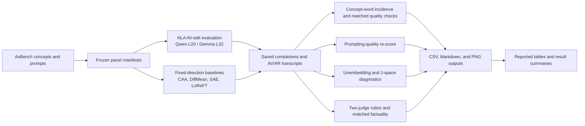

# Experiment architecture

The important data boundary is between reproducible source/configuration and
large external assets. Source, frozen configurations, saved completions, result
summaries, and compact vectors are versioned. Base models, NLA checkpoints,
raw generation caches, and API credentials are acquired separately.

The archived-analysis path emits canonical CSV tables, reviewable Markdown,
and high-resolution PNG copies of every table and figure.
